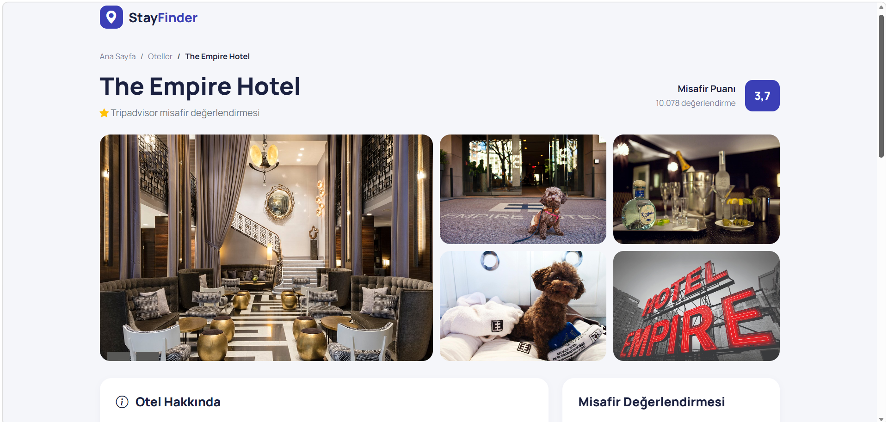
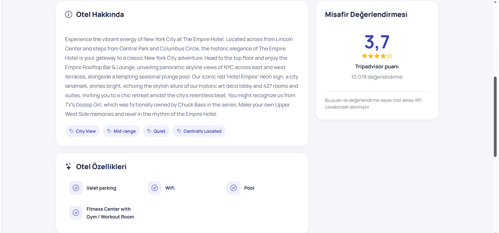

# 🏨 StayFinder – Otel Arama ve Keşif Uygulaması

StayFinder, kullanıcıların farklı şehirlerdeki otelleri arayabilmesini ve oteller hakkında detaylı bilgilere ulaşabilmesini sağlayan ASP.NET Core MVC tabanlı bir web uygulamasıdır.

Proje kapsamında otel arama ve otel detay bilgileri için **RapidAPI üzerinden Tripadvisor API** entegrasyonu gerçekleştirilmiştir.

## ✨ Özellikler

- Şehir veya konuma göre otel arama
- Giriş ve çıkış tarihlerine göre arama yapabilme
- Yetişkin ve çocuk sayısını belirleyebilme
- Oda sayısı ve para birimi seçebilme
- Otel arama sonuçlarını listeleme
- Otel fotoğraflarını görüntüleme
- Otel değerlendirme puanlarını ve yorum sayılarını inceleme
- Otel açıklamalarını ve sunulan olanakları görüntüleme

## 🛠️ Kullanılan Teknolojiler

- C#
- ASP.NET Core MVC
- RapidAPI – Tripadvisor API
- HttpClientFactory
- Dependency Injection
- DTO ve ViewModel
- System.Text.Json
- FluentValidation
- LINQ
- User Secrets
- Async / Await

## ⚙️ Teknik Uygulamalar

- API dokümantasyonunun incelenmesi ve proje gereksinimlerine uygun endpoint ve parametrelerin belirlenmesi
- HTTP isteklerinin oluşturulması ve API yanıtlarının yönetilmesi
- HttpClientFactory ile HTTP istemcilerinin yönetilmesi
- İç içe (nested) JSON yapılarının DTO sınıflarıyla modellenmesi
- System.Text.Json ile JSON verilerinin deserialize edilmesi
- API yanıtlarından ihtiyaç duyulan verilerin ayrıştırılması ve işlenmesi
- API'nin beklediği veri formatlarına uygun istek parametrelerinin hazırlanması
- FluentValidation ile kullanıcı girişlerinin doğrulanması
- Asenkron programlama ile API işlemlerinin gerçekleştirilmesi
- User Secrets ile API anahtarının güvenli şekilde saklanması
- Özel Exception sınıfları ve Global Exception Handler ile merkezi hata yönetimi

## 🔌 API Entegrasyonu

Projede otel arama ve otel detay bilgileri için RapidAPI üzerinden Tripadvisor API kullanılmıştır.

API entegrasyonu sürecinde:

1. API dokümantasyonu incelenerek ihtiyaç duyulan endpoint'ler belirlendi.
2. Endpoint'lerin kabul ettiği parametreler analiz edildi.
3. Kullanıcıdan alınan bilgiler API'nin beklediği formata dönüştürüldü.
4. HttpClientFactory aracılığıyla HTTP istekleri oluşturuldu.
5. API'den dönen JSON yanıtları DTO sınıflarıyla modellendi.
6. Deserialize işlemiyle JSON verileri C# nesnelerine dönüştürüldü.
7. İhtiyaç duyulan veriler uygulama modellerine aktarıldı.

## 🔐 API Anahtarı Yapılandırması

API anahtarı güvenlik amacıyla User Secrets üzerinden yönetilmektedir.

## 🎯 Projenin Amacı

Bu proje ile ASP.NET Core MVC kullanarak harici API entegrasyonu, HTTP isteklerinin yönetimi, JSON veri modelleme ve işleme, DTO yapıları ve asenkron programlama konularında pratik deneyim kazanılmıştır.

## 📸 Ekran Görüntüleri

### Ana Sayfa ve Otel Arama

### Otel Arama Sonuçları

### Otel Detay Sayfası

### Otel Detay Sayfası

